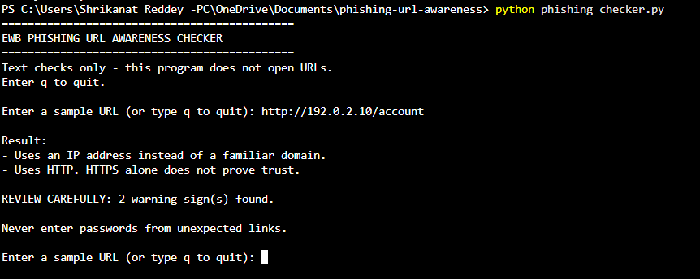
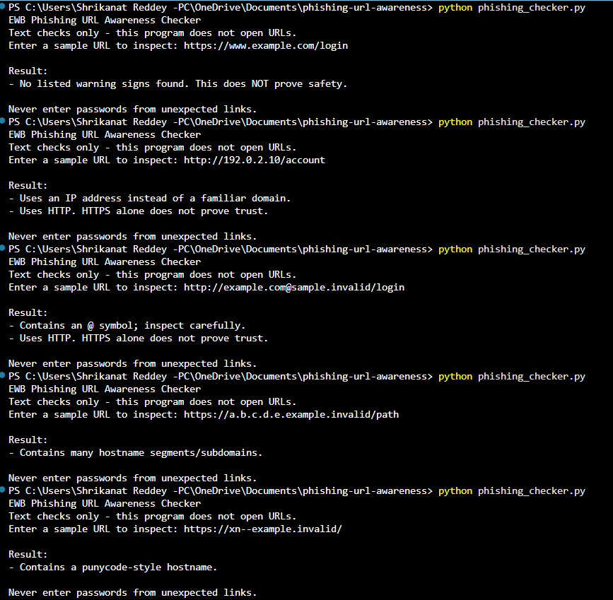

# EWB Phishing URL Awareness Checker

## Overview
Phishing is a cyber attack where criminals use fake links or messages to steal personal information such as passwords and banking details.

This Python project checks URL text for common phishing warning signs and helps users identify suspicious links.

## Features
- Detects @ symbols in URLs.
- Detects unusually long URLs (over 100 characters).
- Detects IP-address hostnames.
- Detects multiple hostname segments.
- Detects punycode-style hostnames (xn--).
- Detects HTTP instead of HTTPS.
- Allows checking multiple URLs without restarting.
- Displays a REVIEW CAREFULLY warning summary.
- Handles malformed URL input.

## Technologies Used
- Python 3
- VS Code
- Regular Expressions
- URL Parse Library

## Requirements
- Python 3.10 or later.
- No additional packages required.

## How to Run

1. Open the project folder in VS Code.
2. Open the terminal.
3. Run:

   python phishing_checker.py

4. Enter a sample URL.
5. Type q to exit.

## Example Output

EWB PHISHING URL AWARENESS CHECKER

Enter a sample URL:
http://192.0.2.10/account

Result:
- Uses an IP address instead of a familiar domain.
- Uses HTTP. HTTPS alone does not prove trust.

REVIEW CAREFULLY: 2 warning sign(s) found.

## Testing
Five sample URLs were tested:
1. Normal HTTPS URL.
2. IP-address hostname.
3. URL containing @ symbol.
4. URL with multiple hostname segments.
5. Punycode-style hostname.

All five tests produced the expected warning messages.

## Improvements
1. Multiple URL Checking:
   Users can check multiple URLs without restarting the program.

2. Review Carefully Summary:
   The program displays the number of warning signs detected.

3. Error Handling:
   Invalid URL formats are handled without crashing.

## Screenshots

### Sample Run

### Test Results

## Limitations
This is an educational project. It only checks URL text.
It does not open websites, scan for malware or prove that a URL is safe.

No warning signs found does NOT mean a URL is safe.

## Ethical Use
- Use sample URLs for testing.
- Never collect passwords or personal information.
- Do not scan websites without permission.
- Use this project for defensive cybersecurity learning.

## Author
Name: Srikanth Venkatesh Reddy
Batch/Course: Batch 1
Organization: EWB Edutech Private Limited
